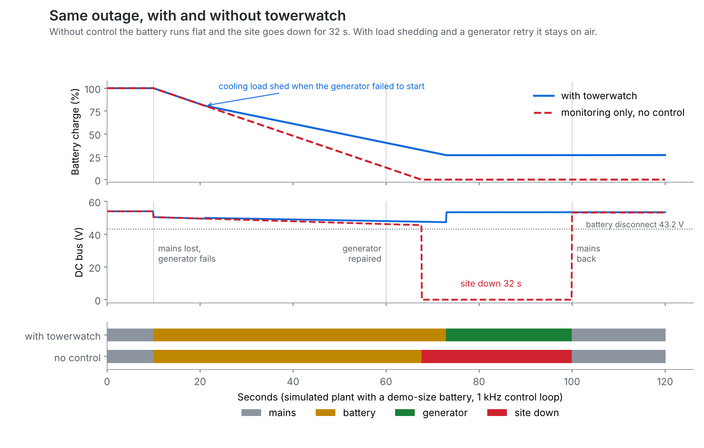

# towerwatch: a real-time power guard for telecom sites, on QNX 8.0

Telecom towers run on a −48 V DC power plant: mains, a standby diesel generator, rectifiers and a battery. When the grid drops and the generator fails to start, the battery runs flat and the site goes off air, often at night and far from the nearest technician.

**towerwatch** samples the site power plant 1,000 times a second on QNX 8.0. It declares a mains failure within milliseconds, starts the generator after a ride-through delay, sheds the non-critical cooling load when the generator fails, retries when it is repaired and restores everything once the bus is healthy. Every tick measures its own wake-up latency and execution time, so the timing can be checked on the target instead of trusted.



In the same simulated outage (mains lost at 10 s, generator fails to start until it is repaired at 60 s, mains back at 100 s), monitoring alone lets the battery run flat and the site goes down for 32 s. With towerwatch in control the site stays on air the whole time. Category: **Robotics & Medical** (real-time applications where timing and reliability are critical).

## What it does

- Samples mains and generator voltage, DC bus voltage, battery current and charge, rectifier modules, loads and cabinet temperature at a fixed rate (default 1 kHz).
- Declares a mains failure after 5 consecutive low samples, so a one-sample blip does not trip it. In the simulation the alarm comes 4 ms after the mains is cut.
- Requests the generator after a 3 s ride-through, raises a generator failure if it is not online within 20 s, sheds the non-critical load (cooling) on battery when the generator has failed, the charge is below 50 % or the bus is below 47.5 V, and restores it after the bus has been healthy for 10 s.
- Raises and clears alarms with hysteresis: mains fail, on battery, generator fail, rectifier fail, battery low, high temperature, load shed, site down.
- Counts every missed deadline, including whole periods skipped, and reports wake-up latency (mean, p99, p99.9, max) and worst tick execution time.
- Keeps energy and diesel counters (grid, generator, battery, solar Wh; litres), the raw data for energy reporting.

## How it uses QNX 8.0

| What | QNX API | Where |
| --- | --- | --- |
| 1 kHz periodic wake-up | `timer_create(CLOCK_MONOTONIC)` with `SIGEV_PULSE_INIT`, `MsgReceivePulse` on a private channel (`ChannelCreate(_NTO_CHF_PRIVATE)`), absolute start with `TIMER_ABSTIME` | `src/towerwatch.c`, `sampler()` |
| Tick execution time | `ClockCycles()`, `SYSPAGE_ENTRY(qtime)->cycles_per_sec` | `src/towerwatch.c`, `work_clock()`, `work_to_ns()` |
| Real-time scheduling | `SCHED_FIFO` thread at priority 40, `mlockall()` | `src/towerwatch.c`, `main()` |
| The plant as a driver-style process | resource manager at `/dev/pwrsim`: `resmgr_attach`, `iofunc_func_init`, `io_read`, `io_devctl` | `src/pwrsim.c` |
| Monitor to plant over message passing | `read()` and `devctl(DCMD_PWRSIM_CMD / DCMD_PWRSIM_FAULT)` on `/dev/pwrsim` | `towerwatch -R`, `src/pwrctl.c` |
| System logging | `slog2_register`, `slog2f` (read with `slog2info`) | `src/towerwatch.c`, `log_event()` |
| Build | `qcc -Vgcc_ntox86_64` (QEMU, PC) or `-Vgcc_ntoaarch64le` (Raspberry Pi 5) | `Makefile`, `make qnx` |
| Image | buildfile lines for the binaries and the scenario | `image/towerwatch.build` |

The protection logic (`src/protect.c`) and the plant model (`src/plant.c`) are plain C with no OS calls, so the same code runs in the QNX real-time loop, in a Linux host build and in the unit tests.

## Build and run on QNX 8.0

Requirements: QNX SDP 8.0 through QNX Everywhere (free for non-commercial use), on a Linux or Windows host; a QNX 8.0 target, either the QEMU x86_64 target from the SDP Quick Start Guide or a Raspberry Pi 5. Toolchain: `qcc` from QNX SDP 8.0.

```sh
source ~/qnx800/qnxsdp-env.sh             # path of your SDP install
make qnx                                  # x86_64 target (QEMU or PC)
make qnx QARCH=gcc_ntoaarch64le           # Raspberry Pi 5
```

Or build on QNX itself: on the QNX Developer Desktop (the self-hosted QNX 8.0 image for QEMU), clone this repository and run `make native`; the binaries land in `build/native/`.

Copy `build/qnx/<arch>/towerwatch`, `pwrsim`, `pwrctl` and `scenarios/outage.txt` to the target (for example with `scp`), then on the target:

```sh
# one process: plant simulated inside towerwatch
./towerwatch -m -d 120 -s outage.txt

# two processes: the plant is a resource manager, towerwatch reads it over message passing
./pwrsim -m &
./towerwatch -m -R -d 120 -s outage.txt
./pwrctl status                           # from another shell: read the plant
./pwrctl mains-off                        # inject a fault live
slog2info                                 # towerwatch events in the system log
```

To add the binaries to a boot image instead, include the lines in `image/towerwatch.build` in your target's buildfile.

### With only a browser: Google Cloud Shell

No QNX host or target at hand? `tools/qnx-cloudshell.sh` does the whole route in Google Cloud Shell (Ubuntu 24.04, free with a Google account), following QNX's documented unattended installation:

```sh
git clone https://github.com/fkamanzi/towerwatch-qnx && cd towerwatch-qnx
bash tools/qnx-cloudshell.sh install   # asks for your myQNX email and password once; QNX Software Center + QNX SDP 8.0
bash tools/qnx-cloudshell.sh all       # qcc build, mkqnximage QEMU image, boot, copy, run the demo
```

`install` activates the QNX Everywhere licence deployed to your myQNX account (`qnxsoftwarecenter_clt -syncLicenseKeys -activateAll`) and installs the `com.qnx.qnx800` baseline. `image` builds a QNX 8.0 x86_64 VM image with `mkqnximage --type=qemu`. `mkqnximage --run` needs a host network bridge (`brctl`, `br0` or `virbr0`) and uses KVM when it can; Cloud Shell has neither, so `boot` starts the same QEMU command that mkqnximage's `runimage` builds for an x86_64 image (IDE disk, virtio-net, virtio-rng, `-kernel ifs.bin`) with TCG emulation and user-mode networking, ssh on `127.0.0.1:10022`. `run` copies the binaries over ssh and runs the three demo runs below, saving the output in `/tmp/qnx/results`.

The emulated CPU shows the software working on QNX 8.0; its timing figures are emulation figures, not what QNX does on real hardware. For timing, run the same commands on a Raspberry Pi 5 or a PC with QNX 8.0.

## Build and test on a Linux host

```sh
make linux && make test
./build/linux/towerwatch -S -m -s scenarios/outage.txt          # virtual time, instant
./build/linux/towerwatch -S -m -n -s scenarios/outage.txt       # same outage, monitoring only
./build/linux/towerwatch -m -d 12 -s scenarios/quick.txt        # real-time loop on Linux
python3 docs/make_chart.py                                      # redraws the chart from the CSV timelines
```

The tests check the debounce, generator start and failure, load shedding and restore, temperature hysteresis, and run the whole outage end to end with and without control.

For comparison, the real-time loop built for Linux and run in a shared cloud container without real-time scheduling (17 Nov 2026) missed 113 of 12,000 periods in 12 s, with a p99 wake-up latency of 370 µs and a maximum of 992 µs. The same loop on QNX 8.0 uses the kernel timer pulse and `SCHED_FIFO`; towerwatch prints the same statistics there, so the two can be compared directly.

## Options

```
-r HZ        sampling rate (default 1000)
-d SECONDS   run time, 0 = until Ctrl-C
-s FILE      scenario: lines of "<seconds> <fault>"
-j FILE      one JSON status line per second
-c FILE      CSV timeline every 100 ms
-p PRIO      SCHED_FIFO priority of the sampling thread (default 40)
-m           demo plant: 1 Ah battery so a two-minute run shows the whole story
-S           simulate in virtual time, no sleeping (tests, charts)
-R           read the plant from the pwrsim resource manager (QNX)
-n           monitoring only: alarms but no commands (baseline)
-q           summary only
```

Faults: `mains-off`, `mains-on`, `gen-no-start`, `gen-ok`, `rect-trip`, `rect-reset`, `aircon-fail`, `aircon-ok`.

## Safety

This is a simulation for developing and testing control software. A real site keeps its certified protection (breakers, low-voltage disconnects, generator controller), and any connection to live equipment goes through the operator's site safety procedure, permits and qualified staff. towerwatch never replaces or bypasses hardware protection.

## Licence

Apache License 2.0, see `LICENSE`. Built by Frutos, Kigali, for the QNX Global Hackathon 2026.
